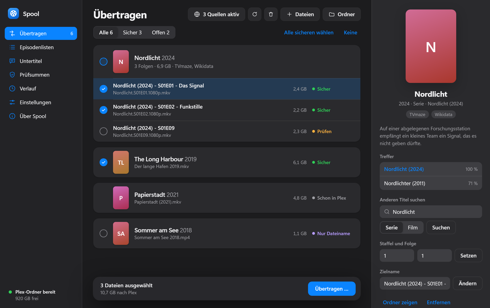

# Spool

[English](README.md) · **Deutsch**

Windows-App, die eigene Filme, Serien und Musik erkennt, sauber benennt und geprüft in eine Plex-Bibliothek überträgt. Rust + Tauri, deutsche Oberfläche.

> Inoffizielles Hobbyprojekt ohne Verbindung zu Plex. „Plex“ ist eine Marke von Plex, Inc. Für eigene Mediendateien gedacht.

<p align="center"></p>
<p align="center"><sub>Screenshots mit erfundenen Titeln.</sub></p>

## Installieren

Windows 10 oder 11, 64 Bit. Installer von der [Release-Seite](https://github.com/azarucha/spool/releases) laden und starten, keine Admin-Rechte nötig. Er ist nicht signiert; Windows SmartScreen fragt deshalb nach („Weitere Informationen“, dann „Trotzdem ausführen“). Fehlt die WebView2-Laufzeit, lädt der Installer sie von Microsoft.

Beim ersten Start fragt Spool nach deinen Plex-Ordnern: automatisch suchen, Hauptordner wählen oder Pfade eintippen (auch `\\server\plex\Filme`). Eine Art genügt.

Einstellungen, Verlauf und verschlüsselte Schlüssel liegen in `%APPDATA%\Spool`. Sie überstehen Updates und Deinstallation; zum Sichern den Ordner kopieren, zum Entfernen löschen.

## Was Spool zusichert

- **Nichts ohne Klick.** Der Dialog zeigt jede Datei mit Ziel; übertragen wird genau diese Liste. Verschieben ist nie voreingestellt.
- **Nie überschreiben.** Existiert das Ziel, ist es ein Konflikt.
- **Nur Fertiges.** Dateien, in die noch jemand schreibt, werden weder angeboten noch übertragen.
- **Geprüft.** Kopien entstehen als `.spool-partial`, werden per SHA-256 am Zwischenspeicher vorbei gegengelesen und erst dann umbenannt. Abbrüche werden fortgesetzt, sobald du dieselbe Datei wieder überträgst.
- **Löschen zuletzt.** Beim Verschieben zuerst kopieren, dann im Verlauf festhalten, dann löschen. Gelöscht wird endgültig, nicht in den Papierkorb.
- **Nicht raten.** „Sicher“ ist nur, was eine Quelle eindeutig bestätigt. Fällt eine Quelle aus, gilt ein neuer Ordner nie als sicher. Suchtreffer und gelernte Zuordnungen musst du bestätigen.
- **Rückgängig**, solange die Zieldatei unverändert ist.

## Datenschutz

An die Datenquellen geht der Titel, den Spool aus Datei- oder Ordnernamen erkennt, dazu Jahr, Staffel und Folge. Hat eine Datei kein erkennbares Muster, ist das der ganze Dateiname ohne Endung; bei überwachten Ordnern werden solche Dateien nicht online gesucht. Für Untertitel kommen Dateigröße und ein Prüfwert dazu. Plakate lädt die App direkt vom Anbieter. Keine Nutzungsdaten, kein Konto.

## Datenquellen

Ohne Schlüssel: [TVmaze](https://www.tvmaze.com) (CC BY-SA), [Wikidata](https://www.wikidata.org) (CC0), [AniList](https://anilist.co), auf Wunsch Filmplakate aus Wikipedia. Mit eigenem Schlüssel: [TheMovieDB](https://www.themoviedb.org), [TheTVDB](https://thetvdb.com), [OMDb](https://www.omdbapi.com) (CC BY-NC), [OpenSubtitles](https://www.opensubtitles.com).

This product uses the TMDB API but is not endorsed or certified by TMDB. Metadata provided by TheTVDB. Please consider adding missing information or subscribing.

## Grenzen

- Nicht mit jeder NAS getestet. Fang mit „Kopieren“ an.
- Mehrteilige oder passwortgeschützte RARs vorher entpacken. Archive in Ordnern werden gezählt, aber nicht automatisch entpackt. 7z und RAR brauchen Windows 11 (dort kann `tar.exe` sie lesen).
- Musik nur nach vorhandenen Tags. Datumsfolgen (Talkshows) brauchen Staffel und Folge von Hand.
- Eine Bibliothek je Art; keine gespeicherte Warteschlange über Neustarts hinweg.

## Entwickeln

`kern/` Logik und Tests, `app/` Fenster und Installer, `ui/` Oberfläche ohne Fremdbibliotheken.

```
cargo test -p kern
cargo run -p kern --example dev -- ui 4173     # Oberfläche im Browser, nur auf localhost
cd app && npx @tauri-apps/cli@2.12.6 build     # Installer (MSVC)
python tools/third_party.py                    # THIRD-PARTY.txt erneuern
```

`SPOOL_HOME` zeigt auf einen anderen Datenordner, praktisch für Tests. `CARGO_TARGET_DIR` am besten außerhalb synchronisierter Ordner. Mit `x86_64-pc-windows-gnullvm` zusätzlich `WebView2Loader.dll` aus dem Build nach `app/vendor/` legen und mit `--config tauri.gnullvm.conf.json` bauen.

## Unterstützen

Spool ist kostenlos und bleibt es. Wenn es dir Arbeit abnimmt, freue ich mich über einen Kaffee auf [Ko-fi](https://ko-fi.com/azarucha). Fehlerberichte mit klarer Beschreibung sind willkommen, Antworten kann ich nicht versprechen.

## Lizenz

[MIT](LICENSE). Bausteine anderer: [THIRD-PARTY.txt](THIRD-PARTY.txt).
