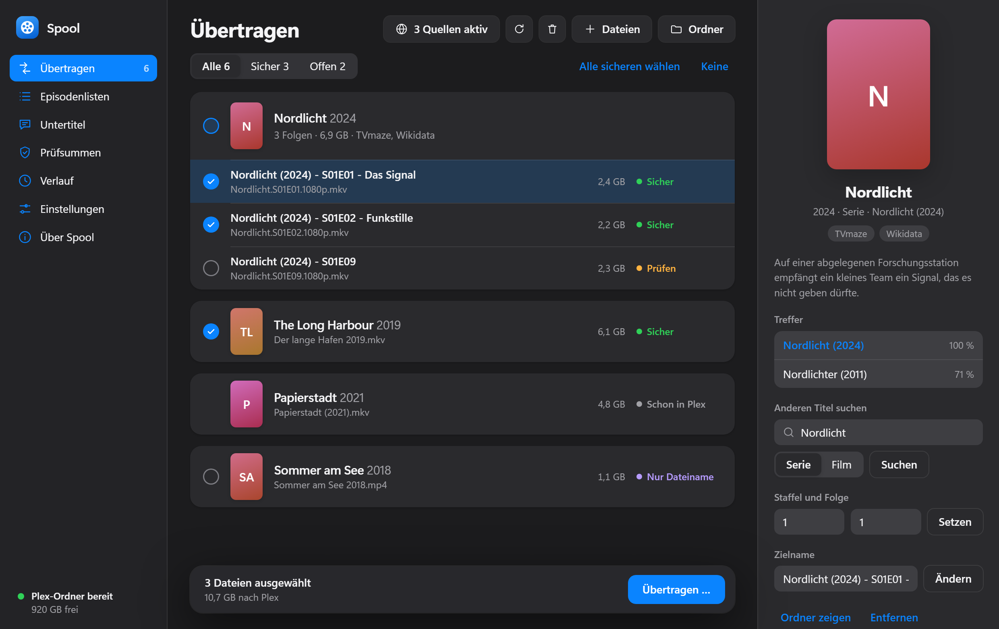
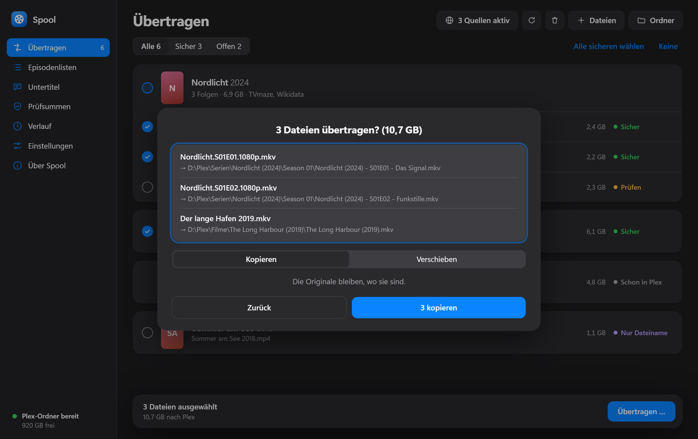

# Spool

**English** · [Deutsch](README.de.md)

**Recognise, rename and safely transfer your own films, series and music into a Plex library.** A small native
Windows app (Rust + Tauri). It shows the exact target of every file before anything happens, verifies every copy
and never overwrites.

[](https://github.com/azarucha/spool/actions/workflows/ci.yml)


<p align="center"></p>
<p align="center"></p>
<p align="center"><sub>Screenshots with made-up titles. The app itself is in German.</sub></p>

> **Unofficial hobby project.** Not affiliated with, endorsed by or supported by Plex. "Plex" is a trademark of
> Plex, Inc. Meant for media files you own. No support, see below.

## Download

Windows 10 or 11 (64-bit): get the installer from the [releases page](https://github.com/azarucha/spool/releases).
No admin rights needed. It is not code-signed, so SmartScreen asks ("More info", then "Run anyway"). This is a beta:
start with *copy* and a few files.

On first start Spool asks where your Plex folders are: search drives, pick the main folder, or type paths, including
network paths such as `\\server\plex\Movies`. One kind (series, films or music) is enough.

## What it does

- **Several sources at once:** TVmaze, Wikidata and AniList work immediately; TheMovieDB, TheTVDB, OMDb and
  OpenSubtitles with your own key. Each can be switched on and off.
- **Finds existing folders** under any known title, so a German file name ends up in the English folder you already have
- **Music** by embedded tags, **archives** (zip, 7z, rar) unpacked, **subtitles** kept next to their film
- Episode lists, checksums (SHA-256, CRC32), history with undo, watched folders, your own naming templates
- Light and dark, keyboard usable, 2.5 MB installer

## What it promises

- **Nothing without a click.** The dialog lists every file and target, and exactly that list is transferred. Moving is
  never preselected.
- **Never overwrites.** An existing target is a conflict.
- **Finished files only.** Files someone is still writing to are neither offered nor transferred.
- **Verified.** Copies are written as `.spool-partial`, read back past the cache, compared by SHA-256 and only then
  renamed. Interrupted copies resume.
- **Deletes last.** Moving copies first, records it in the history, then deletes (permanently, not to the recycle bin).
- **Does not guess.** Only an unambiguous match counts as safe. If a source is down, a new folder never does.

## Privacy

Sources receive the title Spool recognises from the file or folder name, plus year, season and episode. Without a
recognisable pattern that is the whole file name without extension; in watched folders such files are not looked up.
Subtitle search additionally sends the file size and a hash. Posters load directly from their provider. No telemetry,
no account. API keys are encrypted with your Windows account and stay on your computer.

## Limits

- Tested with one NAS so far. Multi-part or encrypted RARs need unpacking first; 7z and RAR need Windows 11.
- Music only by existing tags. Date-based episodes (talk shows) need season and episode by hand.
- One library per kind, no queue across restarts.
- TheMovieDB, TheTVDB, OMDb and OpenSubtitles are covered by tests against a mock server only. Reports welcome.

## Build

`kern/` is the logic with tests, `app/` the window and installer, `ui/` the interface without third-party libraries.

```
cargo test -p kern
cargo run -p kern --example dev -- ui 4173     # UI in the browser, localhost only
cd app && npx @tauri-apps/cli@2.12.6 build     # installer (MSVC)
```

## Support

This is a personal project I share as is. Issues with a clear description are welcome, pull requests even more,
but I can't promise answers or fixes. Spool is free and will stay that way. If it saves you some work, you can
[buy me a coffee on Ko-fi](https://ko-fi.com/azarucha).

## Credits

[TVmaze](https://www.tvmaze.com) (CC BY-SA), [Wikidata](https://www.wikidata.org) (CC0),
[AniList](https://anilist.co), [OMDb](https://www.omdbapi.com) (CC BY-NC),
[OpenSubtitles](https://www.opensubtitles.com), [TheTVDB](https://thetvdb.com): metadata provided by TheTVDB, please
consider adding missing information or subscribing. This product uses the TMDB API but is not endorsed or certified by
[TMDB](https://www.themoviedb.org).

## License

[MIT](LICENSE). Third-party components: [THIRD-PARTY.txt](THIRD-PARTY.txt).
